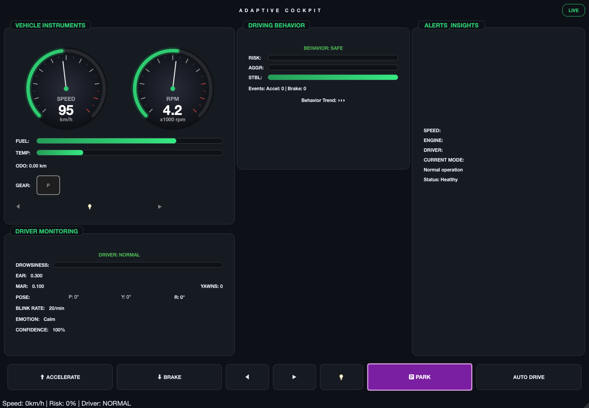
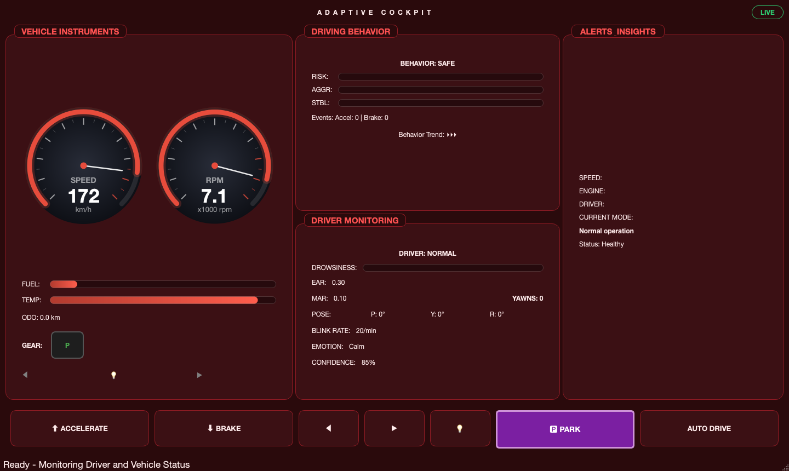
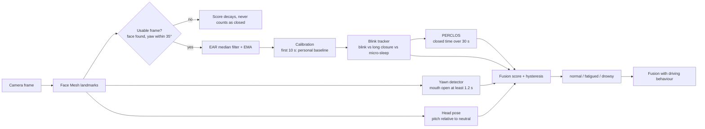
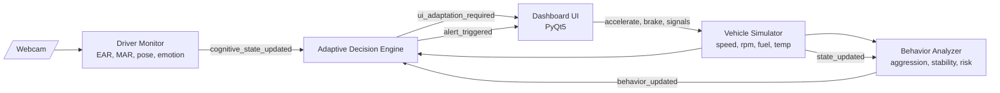
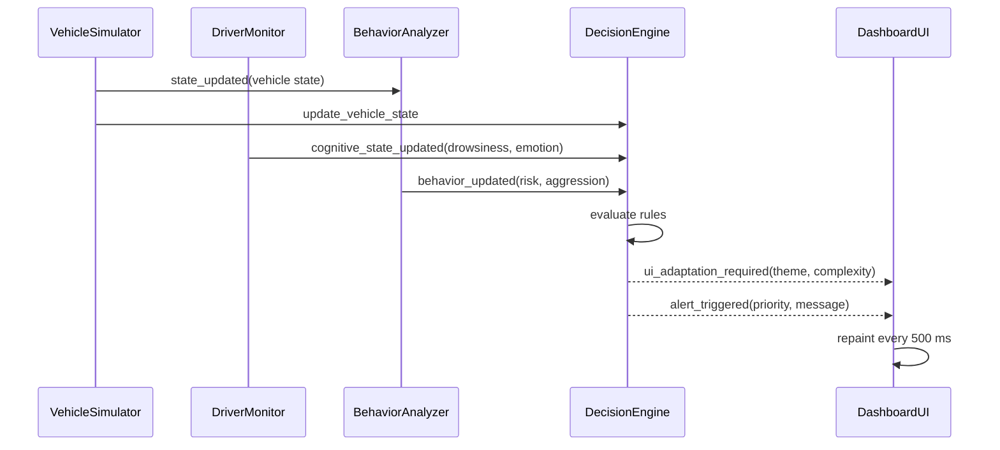
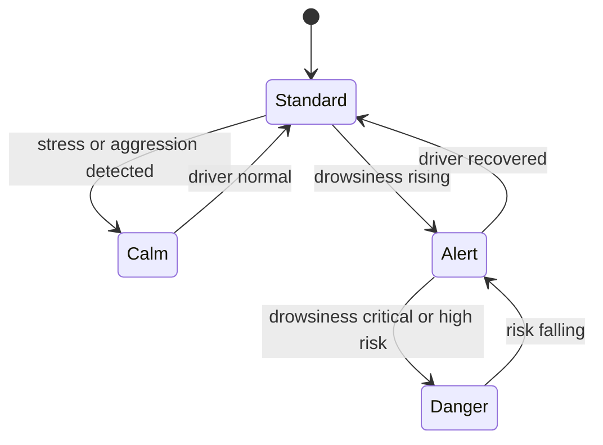
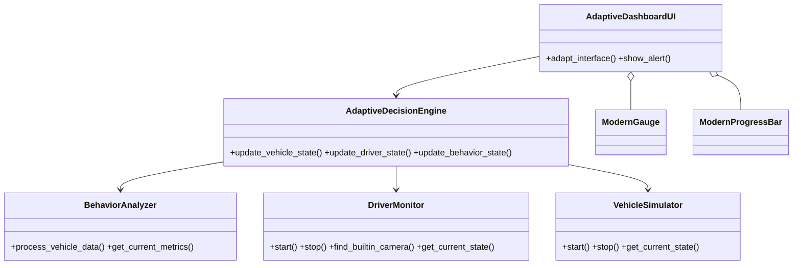

# Adaptive Cockpit: AI-Powered Adaptive Vehicle Dashboard

An automotive HMI simulator that watches the **driver** (webcam + computer vision) and the **vehicle** (simulated telemetry), then adapts the dashboard in real time: layout complexity, colour theme and prioritised alerts change with driver fatigue, emotion and driving behaviour.

*University project, Automotive Software Engineering.*



<sub>Danger theme (critical state): red gauges and bars, minimal UI.</sub>



## Features

- **Driver monitoring**: Eye Aspect Ratio (drowsiness), Mouth Aspect Ratio (yawns), head pose, blink rate and emotion recognition (OpenCV + MediaPipe, optional Keras model).
- **Vehicle simulator**: speed, RPM, gear, fuel, engine temperature, odometer, indicators and headlights.
- **Behaviour analysis**: rolling-window aggression, instability and over-speed scores combined into a risk level.
- **Adaptive decision engine**: rule-based mapping from fused state to UI complexity, colour theme and alerts.
- **Modern PyQt5 UI**: animated dial gauges with colour zones and redline, severity-coloured bars, four themes, floating alerts and audible alarms.

## Drowsiness detection

Detection is calibrated per driver and fuses several cues instead of a single fixed EAR threshold (`src/drowsiness_engine.py`):



| Cue | Weight | Notes |
|-----|-------:|-------|
| PERCLOS (30 s) | 0.40 | 30% or more alone forces a drowsy verdict |
| Long eye closures (0.5 s or more) | 0.20 | three in a minute saturates |
| Mean blink duration | 0.10 | needs at least three blinks |
| Yawns (5 min) | 0.15 | duration based, so talking is ignored |
| Head down (pitch vs neutral) | 0.15 | measured against the calibrated pose |

- **Calibration:** the first 10 seconds learn the driver's open-eye EAR, so glasses, eye shape and camera angle no longer break a fixed 0.20 threshold. No alert fires while calibrating. Call `DriverMonitor.recalibrate()` for a new driver.
- **Micro-sleep:** one continuous closure of 1.5 s or more goes straight to drowsy.
- **Hysteresis and smoothing:** separate enter and exit thresholds plus a time-based score filter (rises in about 1 s, falls in about 4 s) stop the state from flickering and keep behaviour independent of frame rate.
- **Fusion with the vehicle:** a fatigued driver whose behaviour risk is above 0.5 (or stability below 0.4) is escalated to drowsy by the decision engine.
- **Alarm:** while drowsiness stays high (drowsy state or level 0.65+), the alarm repeats every 2 s and the header turns red with "DROWSY!". On macOS it uses the system sound player, so it still works when the audio library cannot open a device.
- **Robustness:** frames with no face or an extreme head turn are skipped, never treated as closed eyes. Processing runs at about 30 FPS so short blinks are seen.

### Evaluate and tune

```bash
cd src
python evaluate_drowsiness.py --synthetic        # built-in sanity benchmark
python evaluate_drowsiness.py --csv features.csv # your labelled data
```

The script reports precision, recall, F1 and false alarms per hour. Extract per-frame features (`t,ear,mar,pitch,yaw,label`) from a labelled dataset such as NTHU-DDD or UTA-RLDD and tune `DrowsinessConfig` against those numbers. The synthetic run only checks the pipeline; it is not evidence of real-world accuracy.

## Architecture

### System overview



### Signal flow (one update cycle)



### Adaptive state machine



| Theme | UI complexity | Trigger |
|-------|---------------|---------|
| Standard | Full | Normal driving |
| Calm | Reduced | Stress or aggressive driving |
| Alert | Reduced | Early fatigue |
| Danger | Minimal | Critical drowsiness or high risk |

### Module map



## Project structure

```
adaptive-dashboard-system/
├── src/
│   ├── main.py                 # entry point, wires modules via Qt signals
│   ├── modern_dashboard_ui.py  # PyQt5 UI (gauges, themes, alerts)
│   ├── dashboard_ui.py         # earlier UI version
│   ├── driver_monitor.py       # camera, face mesh, emotion model
│   ├── drowsiness_engine.py    # calibration, PERCLOS, fusion
│   ├── evaluate_drowsiness.py  # offline precision/recall tool
│   ├── vehicle_simulator.py    # telemetry simulation
│   ├── behavior_analyzer.py    # driving behaviour scoring
│   └── decision_engine.py      # adaptation rules
├── web/                        # browser version (deployed on Vercel)
├── config/settings.json        # thresholds and weights
├── tests/                      # pytest suite
├── docs/                       # design documents and images
└── requirements.txt
```

## Live camera preview

The Alerts & Insights panel shows a mirrored live camera view with eye and mouth landmarks. The border and caption follow the driver state (green normal, amber fatigued, red drowsy) and show calibration progress and PERCLOS.

## Web version (Vercel)

**Live demo: https://adaptive-cockpit-dashboard.vercel.app**

The desktop app (PyQt5) cannot run on Vercel, so the `web/` folder is a browser version of the driver-monitoring dashboard. Detection runs entirely in the browser, and video is never uploaded.

| Desktop | Web |
|---------|-----|
| OpenCV camera capture | `getUserMedia` (needs HTTPS, which Vercel provides) |
| MediaPipe Face Mesh (Python) | MediaPipe Face Landmarker (WASM, client-side) |
| `src/drowsiness_engine.py` | `web/engine.js` (same thresholds and logic) |
| PyQt dashboard | HTML, CSS and canvas gauges |
| `afplay` / sounddevice alarm | Web Audio API |

Use **Start camera** for live detection or **Demo (no camera)** to watch a simulated driver go from alert to drowsy. The web version has the calibrated engine, PERCLOS, yawns, head pose, repeating alarm and adaptive theme, plus a simple speed gauge. It does not include the emotion model or the behaviour analyzer.

Run it locally and test the engine:

```bash
cd web && python3 -m http.server 8000   # open http://localhost:8000
node --test web/engine.test.mjs
```

Deploy your own copy:

```bash
npx vercel deploy --prod
```

`vercel.json` serves the `web/` folder as a static site and `.vercelignore` keeps the Python sources out of the deployment.

## Getting started

```bash
git clone <this-repo-url>
cd adaptive-dashboard-system
python3 -m venv venv && source venv/bin/activate
pip install -r requirements.txt
cd src && python main.py
```

On first run macOS asks for camera permission. Without a webcam the vehicle simulation and UI still run.

**Emotion model:** the trained `emotion_model.h5` (about 43 MB) is not stored in git. Place your own model at the project root; the monitor falls back to the geometric features (EAR/MAR/pose) when it is absent.

### Camera permission (macOS)

macOS grants camera access to the app that launches Python, so run `main.py` from your own Terminal and click **Allow** on the prompt. If you see `not authorized to capture video`, enable the terminal under System Settings → Privacy & Security → Camera, then fully restart it. Without a camera, the dashboard still runs; only driver monitoring (EAR, MAR, emotion) stays idle.

### Demo

1. Start the app (command above). The window sizes itself to your screen.
2. Press **Auto Drive** for random driving, or hold **Accelerate / Brake** yourself.
3. Push speed past the limit or let temperature rise and watch the gauges change colour and alerts appear.
4. With the camera on, close your eyes for a few seconds: drowsiness rises and the theme shifts Standard → Alert → Danger.

### Controls

| Control | Action |
|---------|--------|
| Accelerate / Brake | Hold to change speed |
| ◀ ▶ | Toggle turn indicators |
| 💡 | Headlights |
| Park | Shift to park |
| Auto Drive | Random driving for demos |

## Configuration

Tune thresholds in [`config/settings.json`](config/settings.json): EAR drowsiness thresholds, behaviour window and weights, alert durations, UI size.

## Tests

```bash
pytest tests/
```

## Security notes

No credentials or API keys are used. Logs, camera selection state, virtual environments and model weights are excluded through `.gitignore`.

## License

Academic project. Add a license of your choice before reuse.
