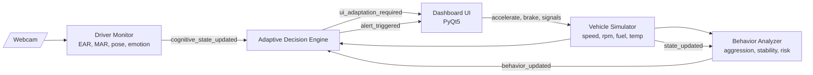
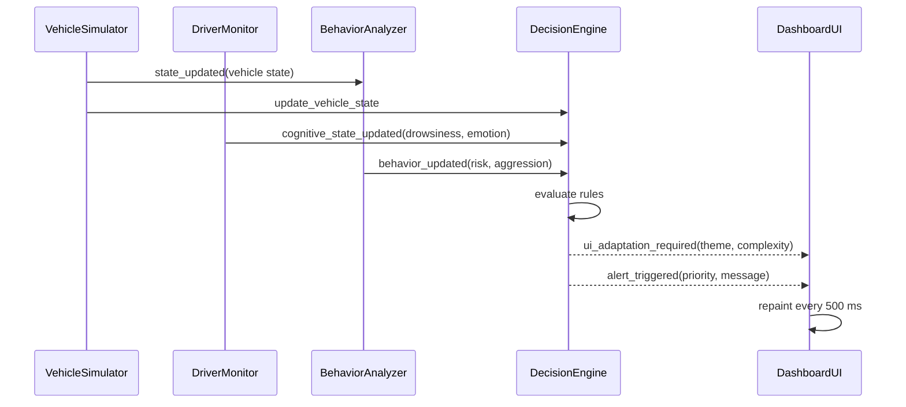
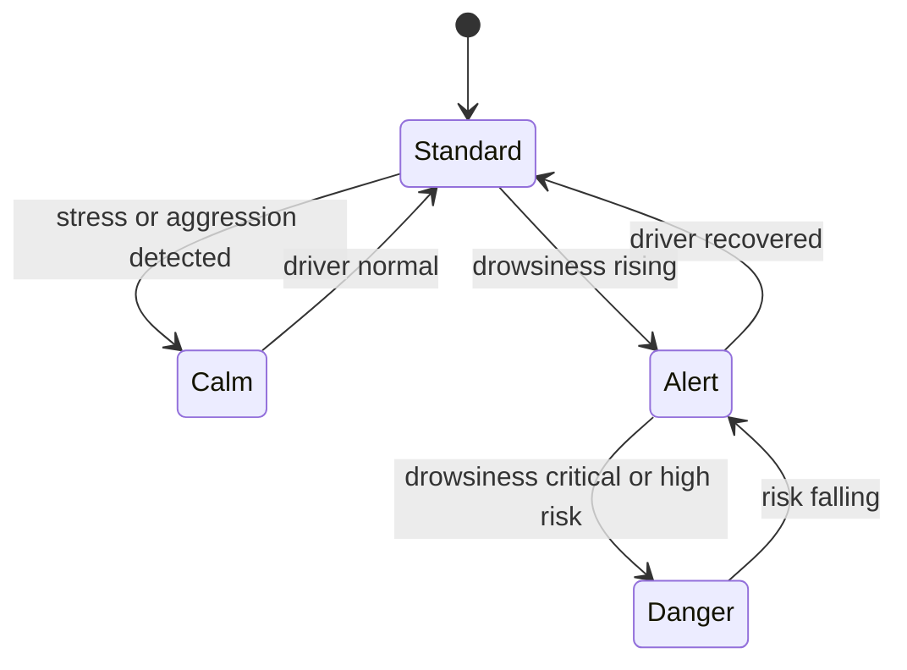
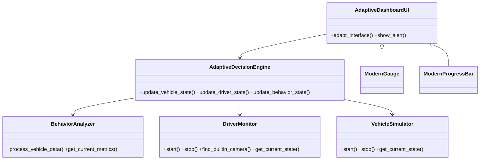

# Adaptive Cockpit: AI-Powered Adaptive Vehicle Dashboard

An automotive HMI simulator that watches the **driver** (webcam + computer vision) and the **vehicle** (simulated telemetry), then adapts the dashboard in real time: layout complexity, colour theme and prioritised alerts change with driver fatigue, emotion and driving behaviour.

*University project, Automotive Software Engineering.*


## Features

- **Driver monitoring**: Eye Aspect Ratio (drowsiness), Mouth Aspect Ratio (yawns), head pose, blink rate and emotion recognition (OpenCV + MediaPipe, optional Keras model).
- **Vehicle simulator**: speed, RPM, gear, fuel, engine temperature, odometer, indicators and headlights.
- **Behaviour analysis**: rolling-window aggression, instability and over-speed scores combined into a risk level.
- **Adaptive decision engine**: rule-based mapping from fused state to UI complexity, colour theme and alerts.
- **Modern PyQt5 UI**: animated dial gauges with colour zones and redline, severity-coloured bars, four themes, floating alerts and audible alarms.

## Architecture

### System overview



### Signal flow (one update cycle)



### Adaptive state machine



| Theme | UI complexity | Trigger |
|-------|---------------|---------|
| Standard | Full | Normal driving |
| Calm | Reduced | Stress or aggressive driving |
| Alert | Reduced | Early fatigue |
| Danger | Minimal | Critical drowsiness or high risk |

### Module map



## Project structure

```
adaptive-dashboard-system/
├── src/
│   ├── main.py                 # entry point, wires modules via Qt signals
│   ├── modern_dashboard_ui.py  # PyQt5 UI (gauges, themes, alerts)
│   ├── dashboard_ui.py         # earlier UI version
│   ├── driver_monitor.py       # computer vision / emotion model
│   ├── vehicle_simulator.py    # telemetry simulation
│   ├── behavior_analyzer.py    # driving behaviour scoring
│   └── decision_engine.py      # adaptation rules
├── config/settings.json        # thresholds and weights
├── tests/                      # pytest suite
├── docs/                       # design documents and images
└── requirements.txt
```

## Getting started

```bash
git clone <this-repo-url>
cd adaptive-dashboard-system
python3 -m venv venv && source venv/bin/activate
pip install -r requirements.txt
cd src && python main.py
```

On first run macOS asks for camera permission. Without a webcam the vehicle simulation and UI still run.

**Emotion model:** the trained `emotion_model.h5` (about 43 MB) is not stored in git. Place your own model at the project root; the monitor falls back to the geometric features (EAR/MAR/pose) when it is absent.

### Controls

| Control | Action |
|---------|--------|
| Accelerate / Brake | Hold to change speed |
| ◀ ▶ | Toggle turn indicators |
| 💡 | Headlights |
| Park | Shift to park |
| Auto Drive | Random driving for demos |

## Configuration

Tune thresholds in [`config/settings.json`](config/settings.json): EAR drowsiness thresholds, behaviour window and weights, alert durations, UI size.

## Tests

```bash
pytest tests/
```

## Security notes

No credentials or API keys are used. Logs, camera selection state, virtual environments and model weights are excluded through `.gitignore`.

## License

Academic project. Add a license of your choice before reuse.
